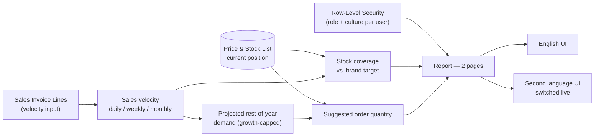

# Inventory Analytics

A **Power BI** inventory-monitoring solution built for a multi-brand FMCG/consumer-
goods distribution business — stock position, coverage health, and a sales-velocity-
driven replenishment signal, entirely derived from sales data rather than purchasing
or supplier records.

This repository documents the architecture and DAX behind this **Inventory
Analytics** solution. It's a portfolio write-up, not the live report: all entity
names in the underlying model are generic sample labels (`Product 001`, `Brand 1`…),
and no real business figures, screenshots, or connection details are included here.

## Business context

The business distributes ~10 brands, each with its own realistic shelf-life and
turnover profile — so a single "carry 6 weeks of stock" rule doesn't fit the whole
catalog. This solution gives operations a live view of whether each brand and product
sits inside its own healthy coverage range, and a projected reorder signal driven by
how fast the product is actually selling right now — not a static reorder point set
once and forgotten.

## What this covers

- **Current stock position** — value and quantity, expressed the way a warehouse
  actually plans: in base units, cases, and pallets.
- **Coverage health vs. brand-specific targets** — weeks of forward sales the stock
  on hand would cover, benchmarked against each brand's own min/max target, with a
  color-banded status straight from the format string.
- **A capped, growth-aware demand projection** — rest-of-year sales quantity
  projected from prior-year actuals scaled by this year's growth trend, capped to
  prevent one outlier week from distorting the forecast, with a sensible fallback for
  new products with no growth history yet.
- **A suggested order quantity** — projected remaining demand minus stock on hand,
  computed live, not maintained as a manual reorder list.

*Out of scope for this repository:* supplier data, purchase orders, and goods-receipt
tracking are covered in a separate, standalone Power BI project and are
intentionally excluded — this repo covers stock **visibility and replenishment
signal** only.

## Architecture

## Tech stack

- **Power BI** — authored in [PBIP](https://learn.microsoft.com/power-bi/developer/projects/projects-overview) (TMDL) format for source control
- **DAX user-defined functions** — reuses 8 functions from the solution's shared time-intelligence library (see [DAX Functions Used](docs/dax-functions.md))
- **DAX measures** — stock position, coverage, and replenishment logic built on that library (see [DAX Measure Catalog](docs/dax-measures.md))
- **Power Query (M)** — SQL Server import and shaping
- **Row-Level Security** — role- and culture-based, resolved from a single access-control table
- **Dynamic localization** — a live culture toggle driving every page and visual title in the report from one measure

## Documentation

| Doc | Contents |
|---|---|
| [Data Model](docs/data-model.md) | Star schema, ER diagram, table catalog, relationships, RLS, and the per-brand coverage-target design |
| [DAX Functions Used](docs/dax-functions.md) | The 8 shared time-intelligence functions this solution calls, with full DAX bodies |
| [DAX Measure Catalog](docs/dax-measures.md) | Stock position, sales velocity, coverage, and the replenishment-signal measures |
| [Dynamic Titles & Localization](docs/dynamic-titles.md) | The `Security` → `Labels` → `Dynamic Labels` chain in full: the `PageKey` band scheme, every label family worked through, the exact report-visual binding, and what changes to add a language |
| [Report Tour](docs/report-pages.md) | Walkthrough of both pages |

## Highlights worth a closer look

- **Per-brand coverage targets, not one global rule.** Every coverage measure
  benchmarks against the specific brand's own min/max target rather than a
  hard-coded threshold — a fast-moving brand and a slow-moving one can each have a
  correct "healthy" range without any measure logic branching on brand.
- **A demand projection with a sanity cap.** The rest-of-year sales projection scales
  prior-year actuals by this year's growth trend, but caps that scaling at 5× so a
  single anomalous spike can't produce an absurd forecast — and falls back cleanly
  for products without enough history.
- **Coverage status as a format string, not a DAX branch.** The coverage-vs-target
  index carries its own conditional format string ("Over ↑" / "✔" / "Out ↓"),
  keeping the status banding out of the measure logic entirely.
- **Titles bind to measures, never hardcoded text.** Every page title is a hidden
  action-button visual with its title/subtitle bound via `fx` straight to a
  `'Page N | Title'` measure — a text box can't take a measure binding, so this is
  what keeps a title from silently going stale the moment someone edits the page. A
  missing translation surfaces as a visible `⚠` instead of quietly falling back to
  English. Full write-up: [Dynamic Titles & Localization](docs/dynamic-titles.md).

## License

[MIT](LICENSE) — this repository (documentation, DAX/architecture write-ups) may be
reused freely with attribution. It does not include the underlying `.pbix`/PBIP
project files, which remain private.

## Author

**Fuad Gashi** — Power BI / Business Intelligence developer.
[GitHub](https://github.com/fuadgashi)
