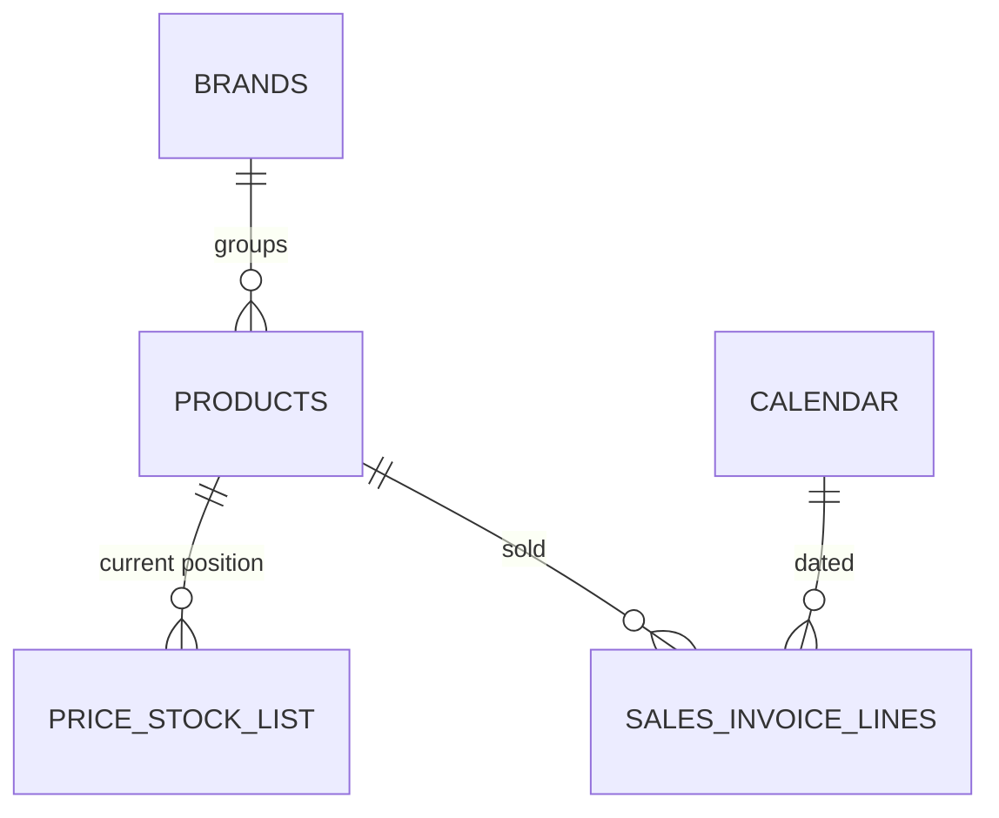

# Data Model

This solution answers one question: *given how fast we're actually selling, is our
stock position healthy, and how much should we plan to move next?* It's a
sales-velocity-driven view of inventory, not a purchasing & supply model — there is
no supplier or goods-receipt data anywhere in this repository.

> **Scope note.** This repository covers **Inventory Analytics** only — current
> stock position, stock-coverage health, and a sales-velocity-driven replenishment
> signal. Sales monitoring, pricing & margin, trade marketing, sales planning,
> purchasing & supply, and portfolio analytics are covered in separate, standalone
> Power BI projects and are out of scope here.

## Entity-relationship diagram

## Table catalog

### Dimensions

| Table | Purpose |
|---|---|
| **Calendar** | Date dimension with working-day helper measures (days elapsed/remaining this year) that drive the rest-of-year sales projection below. |
| **Products** | Product master. Carries case-pack size (units per case) and pallet configuration (cases per pallet), used to express stock in cases and pallets, not just raw units — the units a warehouse actually plans around. |
| **Brands** | Brand master. Carries each brand's **minimum and maximum stock-coverage target**, in weeks — the benchmark every coverage measure is compared against. |

### Facts

| Table | Purpose |
|---|---|
| **Price & Stock List** | Current-position snapshot: one row per product with on-hand quantity, supplier price, selling price, cost, and margin. This is a point-in-time snapshot, refreshed on each data load — not a transactional ledger. |
| **Sales Invoice Lines** | The sales fact table (shared with the Sales Analytics solution) — quantity and net value sold per invoice line. Referenced here purely as the **velocity input** for coverage and replenishment calculations, not reproduced in full; see the [Sales Analytics](https://github.com/fuadgashi/Sales-Analytics) repository for its full measure catalog. |

### Infrastructure (security & localization)

| Table | Purpose |
|---|---|
| **Security** | Row-level-security table — one row per viewer, mapping a UPN to a **role** and a **culture**. Disconnected from the relationship graph; read only through `[User Culture]`. |
| **Labels** | Plain data table — one row per page/visual, per culture, per label role. The source of every piece of user-facing text in the report. Disconnected from the relationship graph. |
| **Dynamic Labels** | Measure-only table hosting one text measure per label, each a lookup against `Labels`. Full reference: [Dynamic Titles & Localization](dynamic-titles.md). |

## Relationships

| From | To |
|---|---|
| Products[BrandId] | Brands[Id] |
| Price & Stock List[ProductId] | Products[Id] |
| Sales Invoice Lines[ProductId] | Products[Id] |
| Sales Invoice Lines[Date] | Calendar[Date] |

## Row-level security & dynamic localization

Three tables work together to drive a genuinely dynamic, bilingual UI — not two
duplicated sets of pages: `Security` resolves *who* is looking and which culture
they should see (`User Culture = SELECTEDVALUE(Security[Culture], "en-US")`);
`Labels` holds *what* every label says, in every supported culture, keyed by a
`PageKey` band scheme; `Dynamic Labels` holds *the lookup* — one measure per label,
bound into the report through hidden action-button visuals rather than text boxes.

The report ships with **English as the default culture** and **Albanian as a fully
supported secondary culture**. Assign a viewer's row a different `Culture` value and
every page and visual title relabels instantly; adding a third language means adding
rows to `Labels`, not touching a single measure or rebuilding the report.

Full reference — the key scheme, every label family worked through, the exact `fx`
binding, and what changes to add a language: [Dynamic Titles & Localization](dynamic-titles.md).

## Design note: coverage targets are per-brand, not one global rule

Rather than one blanket "6 weeks of stock" rule, each brand carries its own
min/max coverage target (set once, on the Brands table), and every coverage measure
compares the actual position against that brand's own target. A slow-moving,
long-shelf-life brand and a fast-moving, short-shelf-life brand can carry entirely
different healthy-stock ranges without any measure-level logic changing — only the
underlying table data does.
